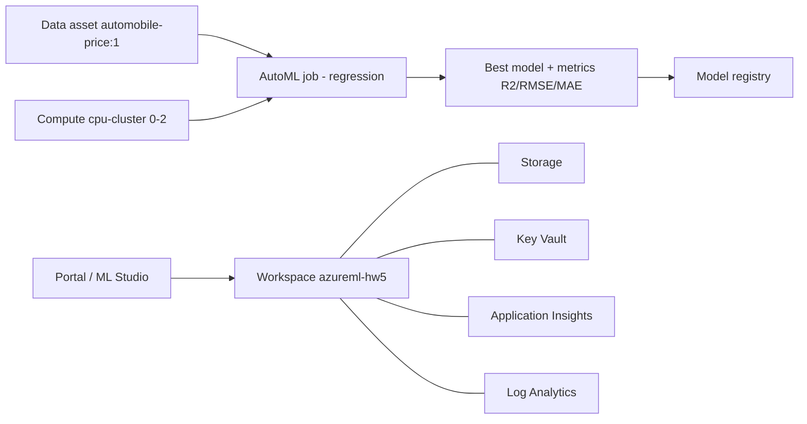

# Arquitectura HW5 — AutoML en Azure Machine Learning

Región: **East US** · Grupo de recursos: `rg-cloudtask-hw5` · Workspace: `azureml-hw5`

## Diagrama

```
                    +-------------------------------------------+
                    |        Azure Portal / ML Studio           |
                    |  (autoría y monitoreo del experimento)    |
                    +----------------------+--------------------+
                                           |
              +----------------------------v-----------------------------+
              |                Azure Machine Learning Workspace          |
              |                     azureml-hw5 (East US)                |
              |                                                          |
              |  +----------------+   +-------------------------------+   |
              |  | Data asset     |   | AutoML Job (regresión)        |   |
              |  | automobile-    |-->|  target: price                |   |
              |  | price:1        |   |  métrica: r2_score            |   |
              |  | (MLTable, 201  |   |  5-fold CV · 10 trials        |   |
              |  |  filas, 25     |   |  featurización automática     |   |
              |  |  features)     |   |  explainability: on           |   |
              |  +----------------+   +---------------+---------------+   |
              |                                       |                  |
              |  +----------------+   +---------------v-------------+    |
              |  | Compute cluster|   | Best model + métricas       |    |
              |  | cpu-cluster    |   | (R², RMSE, MAE)             |    |
              |  | DS3_v2 0-2     |   +---------------+-------------+    |
              |  | nodos          |                   |                  |
              |  +----------------+                   v                  |
              |                          +----------------------------+  |
              |                          | Model registry             |  |
              |                          | automobile-price-best      |  |
              |                          +----------------------------+  |
              |                                                          |
              |  Servicios dependientes (creados por el workspace):      |
              |  Storage Account · Key Vault · Application Insights ·    |
              |  Log Analytics                                           |
              +----------------------------------------------------------+
```



## Componentes

| Componente | Recurso | Rol |
|---|---|---|
| Grupo de recursos | `rg-cloudtask-hw5` (East US) | Contenedor y límite de costos/borrado |
| Workspace AML | `azureml-hw5` | Plano de control: experimentos, datos, cómputo, modelos |
| Data asset | `automobile-price:1` (MLTable) | Dataset UCI Automobile: 201 filas, variable objetivo `price` |
| Compute target | `cpu-cluster` (`Standard_DS3_v2`, 0–2 nodos, idle 5 min) | Entrena los trials; escala a cero cuando no se usa |
| AutoML job | `hw5-automobile-price` | Regresión, `r2_score`, 5-fold CV, 10 trials, 20 min máx |
| Model registry | `automobile-price-best` | Versiona y permite desplegar el mejor modelo |
| Servicios asociados | Storage, Key Vault, App Insights, Log Analytics | Datos, secretos, telemetría y logs (creados por el workspace) |

## Flujo del experimento

1. Curación del dataset (eliminación de filas sin `price`, `?` → vacío para imputación automática).
2. Registro como data asset **MLTable** (formato tabular recomendado para AutoML).
3. Configuración del job: tarea regresión, objetivo `price`, validación cruzada de 5 folds,
   métrica primaria R², featurización automática (one-hot, imputación, escalado).
4. AutoML prueba varios algoritmos (LightGBM, XGBoost, Random Forest, regresiones, etc.) con
   tuning de hiperparámetros y **early termination**.
5. El mejor trial se evalúa y se registra como modelo; se habilitan explicaciones (importancia de variables).
6. Monitoreo en Studio: métricas por trial, gráficos, logs, uso de CPU del clúster.

## IA responsable aplicada

- **Transparencia/explicabilidad:** `enable_model_explainability: true` para ver qué variables pesan
  (p. ej., `curb_weight`, `engine_size`, `horsepower`) y poder justificar predicciones.
- **Justicia:** el dataset incluye `make`/marcas; se documenta el riesgo de sesgo por marca/origen y se
  evita usar el modelo para decisiones que afecten personas sin revisión.
- **Privacidad/seguridad:** datos públicos, sin PII; acceso al workspace por Entra ID y secretos en Key Vault.
- **Confiabilidad:** validación cruzada (no un único split), límites de tiempo y monitoreo de métricas.
- **Responsabilidad:** el modelo se usa como apoyo; un humano valida decisiones de negocio.
