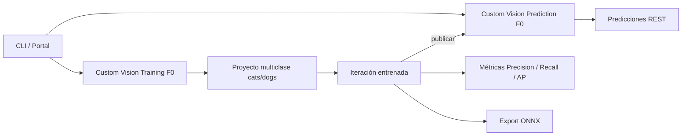

# Arquitectura HW7 — Custom Vision (clasificación de imágenes)

Región: **South Central US** · Grupo de recursos: `rg-cloudtask-hw7`
Proyecto: `hw7-cats-vs-dogs` (id `7dac69cf-910e-4516-ba43-2af1bae7ddb9`)
Dominio: **General (compact)** · Clasificación: **Multiclase (cats / dogs)**

## Diagrama

```
                 +----------------------------------------+
                 |        Azure Portal / CLI               |
                 |  (creación de recursos y claves)        |
                 +-------------------+--------------------+
                                     |
        +----------------------------v-----------------------------+
        |              Grupo de recursos rg-cloudtask-hw7          |
        |                                                          |
        |  +---------------------------+  +---------------------+  |
        |  | Custom Vision Training    |  | Custom Vision       |  |
        |  | cv-hw7-train-4632 (F0)      |  | Prediction          |  |
        |  | endpoint + Training-Key   |  | cv-hw7-pred-4632 (F0)    |  |
        |  +-------------+-------------+  +----------+----------+  |
        |                |                           |             |
        |                v                           |             |
        |   +-------------------------------+        |             |
        |   | Proyecto hw7-cats-vs-dogs     |        |             |
        |   | 60 imágenes de entrenamiento  |        |             |
        |   | (30 cats / 30 dogs)           |        |             |
        |   | Etiquetas + iteración         |        |             |
        |   | entrenada (quick training)    |        |             |
        |   +---------------+---------------+        |             |
        |                   |                        |             |
        |          publica  v                        v             |
        |   +-------------------------------+  +------------------+ |
        |   | Iteration 1 (publicada)       |->| Predicción REST  | |
        |   | métricas Precision/Recall/AP  |  | 20 imágenes test | |
        |   +---------------+---------------+  +------------------+ |
        |                   |                                      |
        |                   v                                      |
        |   +-------------------------------+                      |
        |   | Exportación ONNX (zip)        |                      |
        |   | modelo para borde             |                      |
        |   +-------------------------------+                      |
        +----------------------------------------------------------+
```



## Componentes

| Componente | Recurso | Rol |
|---|---|---|
| Grupo de recursos | `rg-cloudtask-hw7` (South Central US) | Contenedor y límite de costos |
| Custom Vision Training | `cv-hw7-train-4632` (F0) | Entrenamiento, etiquetas, iteraciones, métricas |
| Custom Vision Prediction | `cv-hw7-pred-4632` (F0) | Endpoint para clasificar imágenes nuevas |
| Proyecto | `hw7-cats-vs-dogs` | Clasificación multiclase (2 etiquetas) |
| Dataset | 60 train (30+30) + 20 hold-out (10+10) | Imágenes Cats vs Dogs (Microsoft/Kaggle) |
| Iteración | `b6f2d2f5-25db-4348-996b-bca86125d1ba` (`hw7-iter1`) | Modelo entrenado, publicado y exportado |
| Exportación | ONNX `.zip` (4,4 MB) | Modelo portable para inferencia local/borde |

## Flujo

1. Creación de los recursos Training y Prediction en F0 (gratuitos) vía CLI.
2. Preparación y validación del dataset (se descartan imágenes corruptas).
3. Proyecto de clasificación multiclase con dominio **General (compact)** para permitir exportación.
4. Carga de 30 imágenes por clase con su etiqueta.
5. Entrenamiento rápido (`trainingType=Regular`) y consulta de métricas por etiqueta.
6. Publicación de la iteración para el endpoint de predicción.
7. Evaluación con 20 imágenes reservadas: exactitud, precisión, recall y matriz de confusión.
8. Exportación del modelo a ONNX.

## Decisiones

- **F0:** sin costo y suficiente para 60 imágenes y decenas de predicciones.
- **General (compact):** permite exportar el modelo (ONNX) y sigue siendo preciso para un problema simple.
- **Multiclase:** cada imagen tiene exactamente una etiqueta (cats o dogs), a diferencia de multietiqueta.
- **Hold-out separado:** 20 imágenes nunca vistas permiten medir exactitud real, además de las métricas
  internas de Custom Vision.
- **South Central US:** la suscripción Azure for Students tiene una política que solo permite
  `chilecentral`, `northcentralus`, `southcentralus`, `canadacentral` y `westus2`. Custom Vision no está
  disponible en Chile Central ni Canadá Central; South Central US es la opción soportada más cercana a Perú.
