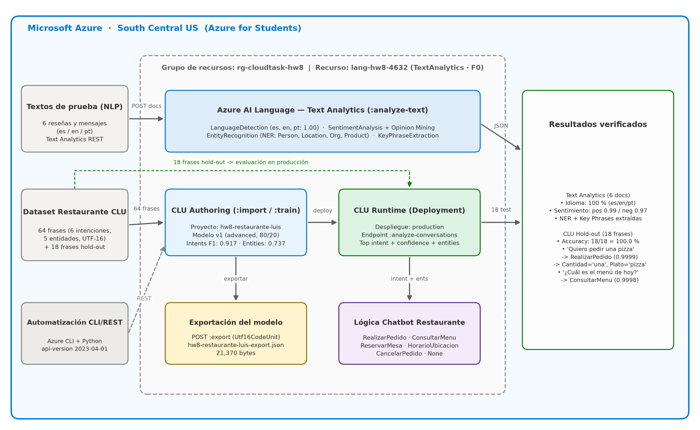

# Arquitectura HW8 — Procesamiento de Lenguaje Natural y CLU (sucesor de LUIS)

Región: **South Central US** · Grupo de recursos: `rg-cloudtask-hw8`  
Recurso: `lang-hw8-4632` (`TextAnalytics`, nivel **F0**)  
Proyecto CLU: `hw8-restaurante-luis` · Idioma: `es` · Despliegue: `production`

## Diagrama

Flujo: textos y frases de restaurante → recurso unificado **Azure AI Language** (`lang-hw8-4632`, F0) →
(1) **Text Analytics** (`:analyze-text`) para idioma, sentimiento con *opinion mining*, NER y palabras clave;
(2) **Conversational Language Understanding (CLU)** (`:import` → `:train` → `deployments/production` →
`:analyze-conversations`) para clasificar 6 intenciones y extraer 5 entidades, más exportación del modelo
a JSON (`:export`).

## Nota técnica sobre LUIS y Azure AI Language

Microsoft retiró oficialmente el servicio clásico **Language Understanding (LUIS)** el 31 de marzo de 2026
y consolidó sus capacidades junto a Text Analytics dentro de **Azure AI Language** bajo el módulo
**Conversational Language Understanding (CLU)**. Adicionalmente, en la suscripción estudiantil (`Azure for Students`),
`az cognitiveservices account list-skus` confirma que `LUIS` y `LUIS.Authoring` ya no ofrecen SKUs disponibles
en ninguna de las regiones permitidas (`southcentralus`, `westus2`, `northcentralus`, `canadacentral`,
`chilecentral`), mientras que `TextAnalytics` (`F0`) en `southcentralus` habilita en un mismo recurso tanto
las APIs de Text Analytics como la creación, entrenamiento, despliegue y exportación de modelos CLU.

## Componentes

| Componente | Recurso / Artefacto | Rol |
|---|---|---|
| Grupo de recursos | `rg-cloudtask-hw8` (South Central US) | Contenedor lógico y limpieza del laboratorio |
| Azure AI Language | `lang-hw8-4632` (`TextAnalytics`, F0) | Endpoint único para Text Analytics y CLU |
| Text Analytics | API `:analyze-text` (`2023-04-01`) | Detección de idioma, sentimiento, NER y palabras clave |
| Proyecto CLU | `hw8-restaurante-luis` (`Conversation`, `es`) | 6 intenciones, 5 entidades, 64 frases de entrenamiento |
| Modelo entrenado | `v1` (`trainingMode: advanced`, split 80/20) | Clasificación de intenciones y extracción de entidades en español |
| Despliegue | `production` (`:analyze-conversations`) | Inferencia en tiempo real para chatbot de restaurante |
| Exportación | `infra/nlp/out/hw8-restaurante-luis-export.json` | Definición portable del modelo exportado desde Azure (21,370 bytes) |
